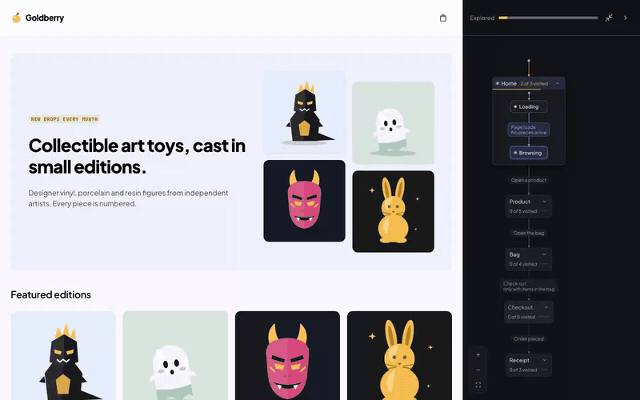
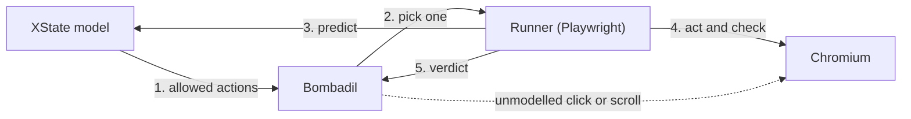
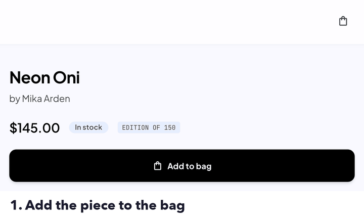
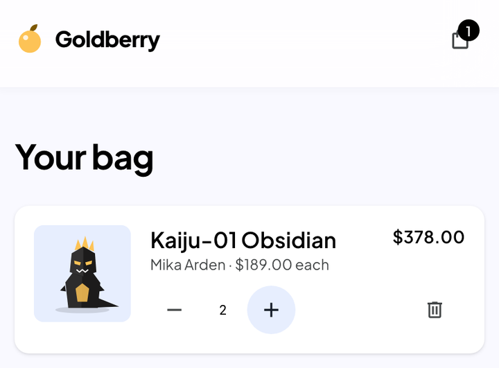
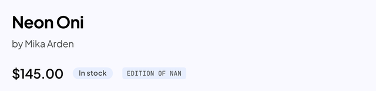

# Goldberry: model-based testing with XState, Playwright and Bombadil

What if a model could guide a random walk? That's the idea we're exploring here. An XState statechart describes how a shop should behave, and [Bombadil](https://github.com/antithesishq/bombadil) wanders the shop in a real browser while the model tells it where it may go and judges where it lands.



Regular test scripts only catch the scenarios you thought of, and random clicking can't reach conditional paths, like the payment step that only shows up after a valid address. Here the model guides Bombadil step by step: it shows which actions make sense now and what the page should look like after each one. If Bombadil wanders away from the plan, the model works out where it ended up and carries on checking from there.

The shop under test is [Goldberry](frontend/README.md), a small art toy store with a mocked backend. The model is written from the shop's documentation ([its README](frontend/README.md) and [API contract](contracts/openapi.yaml)), never from its code. That matters: a model copied from the code agrees with the code by construction, bugs included. Written separately, every disagreement is either a shop bug or a gap in the docs.

## Run it

You need Node 22.22 or later, on macOS arm64 or Linux (Bombadil ships binaries for those two).

```sh
corepack enable
pnpm install
pnpm --filter goldberry-testing exec playwright install chromium

pnpm test:regression    # the model's 9 planned paths, about 1.5 min
pnpm explore            # Bombadil wanders for 90 s, the model judging each step
pnpm demo               # 60 s in a visible browser, with the model drawn beside the shop
pnpm tally              # every bug, 10 runs each, prints the "What it finds" table, about 30 min
```

The tests build and serve the shop themselves. To watch a planted bug get caught, name it:

```sh
GOLDBERRY_BUGS=reload-forgets-bag pnpm explore
```

## What it finds

Three bugs are planted in the shop ([`frontend/src/bugs.ts`](frontend/src/bugs.ts)), all off unless named. Each one ran three ways:

- **XState:** the regression, the model's 9 planned paths.
- **Bombadil:** 10 explorations of 90 s with the model's judging off.
- **XState + Bombadil:** 10 explorations of 90 s, the model judging every step.

| Bug                                            | XState | Bombadil | XState + Bombadil | Caught by                           |
| ---------------------------------------------- | ------ | -------- | ----------------- | ----------------------------------- |
| `edition-nan`: "Edition of NaN"                | 9/9    | 10/10    | 10/10             | `noRenderingSlips`                  |
| `reload-forgets-bag`: a reload empties the bag | 8/9    | 0/10     | 10/10             | the model's prediction              |
| `bag-count-lines`: the header counts lines     | 0/9    | 0/10     | 10/10             | the header count check, after a `+` |

On the healthy shop, all three stayed green: no false alarms in 9 paths and 20 explorations.

The combined runs hit the bugs at a median step of 1, 11 and 37, out of about 150 steps in a 90 s run.

What the numbers say:

- **Without the model, a wrong page looks fine.** Bombadil on its own never caught the emptied bag or the wrong count. The page rendered, nothing threw, and there was nothing to compare it with.
- **The planned paths only find what they walk past.** The regression keeps every quantity at 1, so XState on its own can't see `bag-count-lines`. Combined, it was found every time, because Bombadil presses `+` on the bag page on its own and the model reads the new quantity back.
- **Cheap checks still earn their place.** `edition-nan` needs no model at all: a text scan catches it as soon as a piece's page opens. It once slipped past that scan too, because the badge is styled in capitals ("NAN"), so the scan now checks both.

## Architecture



The model and the runner live in the Playwright test, and Bombadil runs as its own process. Both drive the same Chromium tab over the Chrome DevTools Protocol, and they talk through that tab: the runner writes the allowed actions and each verdict to `sessionStorage`, and Bombadil hands its pick to the runner by calling a function Playwright exposes on the page.

1. **Allowed actions.** The model lists what you may do from the current page.
2. **Pick one.** Bombadil picks one, weighted: moving forward through the shop (open a piece, add it, give an address) counts most, and an action it has already taken often from the same state counts less. About 40% of the time it does something the model doesn't cover instead, like clicking a header link, changing a quantity or scrolling.
3. **Predict.** The model says which page should come next.
4. **Act and check.** Playwright does the action and checks that the predicted page appears. After an unplanned click, the model finds where the browser landed among its own pages and checks it there; a page it doesn't know fails.
5. **Verdict.** The runner tells Bombadil whether the step passed, and Bombadil adds its own checks. The first failure stops the run and writes a case file explaining it.

The model only covers the main way through the shop: open a piece, add it, view the bag, check out, give an address, pay, plus Back and Reload anywhere. Everything else is left to Bombadil. Its own clicks never add to the bag, open checkout or touch the checkout form, so they can't change the shop behind the model's back. They can only change what the model reads back afterwards: the URL, the browser history and the stored bag.

The same model also drives the regression: 9 fixed paths that together take every transition at least once.

## Invariants

An invariant is a property that must hold after every step. The idea goes back to Alan Turing's [_Checking a Large Routine_](https://turingarchive.kings.cam.ac.uk/publications-lectures-and-talks-amtb/amt-b-8) (1949), one of the first proofs that a program is correct. To make a long routine checkable, he wrote, "the programmer should make a number of definite assertions which can be checked individually", and he proved his routine with invariants that hold at each stage of its loops.

In Bombadil, a property is a formula over what it reads from the page, and wrapping it in `always` makes it an invariant: Bombadil checks it on every state it reaches, and the first state where it is false stops the run. Ours live in [`testing/bombadil/spec/properties.ts`](testing/bombadil/spec/properties.ts):

```ts
/** The last step landed where the model predicted, on a page it knows, and passed its checks. */
export const modelHolds = always(() => model.current?.verdict?.ok !== false)

/** No console errors; failed requests are left to noHttpErrorCodes. */
export const noConsoleErrors = always(
  () => (pageHealth.current?.consoleErrors.length ?? 0) === 0,
)

/** No "NaN", "undefined" or "[object Object]" on screen, as written or in capitals. */
export const noRenderingSlips = always(
  () => (pageHealth.current?.renderingSlips.length ?? 0) === 0,
)

/** Wherever a price summary shows, the bill adds up. */
export const totalsAddUp = always(() => {
  const bill = summaryOf(shop.current?.prices)
  return bill === null || billAddsUp(bill)
})
```

Here are the three planted bugs failing them:

| `reload-forgets-bag`                                                                                                            | `bag-count-lines`                                                                                               | `edition-nan`                                                                                   |
| ------------------------------------------------------------------------------------------------------------------------------- | --------------------------------------------------------------------------------------------------------------- | ----------------------------------------------------------------------------------------------- |
|  |  |  |
| wrong state: the page isn't the predicted one                                                                                   | wrong data: the header count disagrees with the model                                                           | a rendering slip                                                                                |

## A case file

Every failure writes one. Here's a real one for `reload-forgets-bag`, shortened:

```text
Violated: modelHolds
Step: BROWSER_RELOAD (the browser loaded this page by Back or Reload)
The model expected: product › inBag
The page showed: product › available
Why the model expected that (its guards, in the order it evaluated them):
- landsOn:product.inBag: yes (url = "/product/kaiju-01-obsidian", from FOLLOW_LINK("piece:kaiju-01-obsidian")
  at step 7; bag.length = 1, from BROWSER_RELOAD at step 10; ...)
Model journey (oldest first):
- #7 FOLLOW_LINK("piece:kaiju-01-obsidian"): home.ready → product.available
- #8 ADD_TO_BAG: product.available → product.inBag
- #9 loose action: product.inBag → product.inBag
- #10 BROWSER_RELOAD: product.inBag → expected product.inBag, page showed product.available
```

Read it top down: what failed, why the model expected something else and which step set each value it relied on, then the journey that got there. After that it's your call who is right. Here the docs are: the bag lives in `localStorage` and must survive a reload.

## Limits

- **Runs aren't replayable.** Bombadil isn't seeded and case files aren't replayed. The journey in the case file is your way back to the bug.
- **Chromium only.** Bombadil attaches to the browser over the Chrome DevTools Protocol.
- **macOS arm64 and Linux only.** On Intel macOS or Windows, run the exploration in Docker or WSL.
- **The model covers the main path.** A bug that lives only in Bombadil's own clicks is caught when the model reads the result back (like `bag-count-lines`) or by a check that needs no model. Anything else goes unseen.

## Trivia

Bombadil shares its name with Tom Bombadil from Tolkien's _The Lord of the Rings_. In the book, Tom lives on the edge of the Old Forest with Goldberry, the River daughter, so the shop that Bombadil explores here is named after her.
